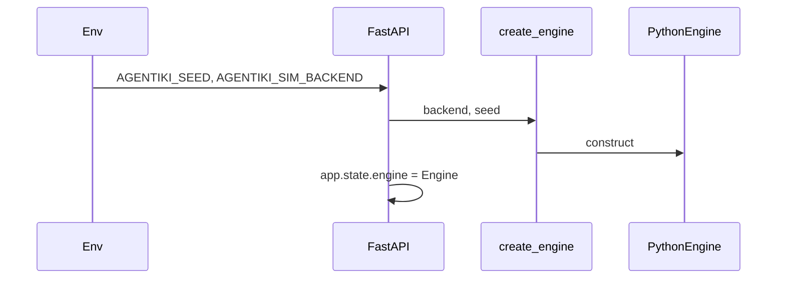
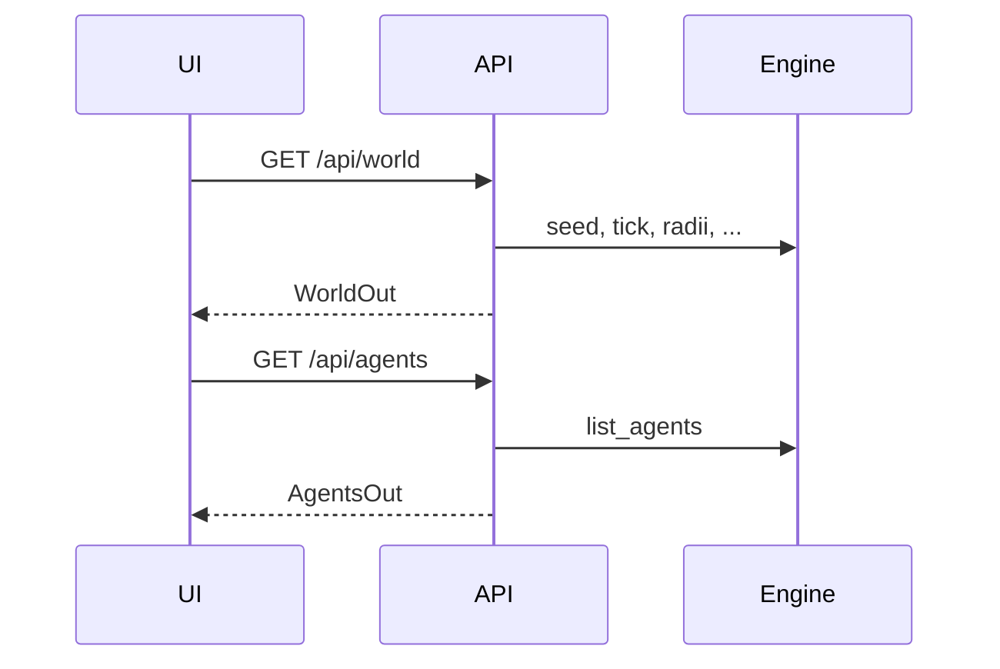
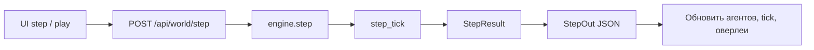

# Потоки данных

## Старт



## Bootstrap UI



## Экраны UI

```text
главная: «Новый мир» | «Загрузить мир»
  → экран конфига (новый пустой или загруженный JSON)
      «Старт»: resetWorld, generateAgents(count, density, life), камера в origin, экран симуляции
      «Сохранить конфиги»: имя → PUT JSON, симуляция не стартует
симуляция: play/pause (шаг n=1 раз в 1 с), «Рестарт», zoom, «Вид», «←»
  «Рестарт»: пауза, reset + generate тем же конфигом сессии, остаться на симуляции,
             камеру не двигать, тик 0
```

На симуляции нет меню числа агентов, плотности и «Жизнь». Кнопок «Шаг» и «×10» нет.

## Генерация агентов

```text
UI POST /api/agents/generate {count, density, map_width, map_height, food_*, life}
  → set_map_size / set_food_rules / set_life_rules, затем engine.generate_agents(...)
    → AgentPopulation.clear + квадратная решётка внутри bounds
      spacing = clamp(round(density), 1, 10)
    → spawn_initial_food(food_capacity)
  → AgentsOut (+ GET /api/food)
```

Seed, который движок передаёт в `generate`, на координаты агентов не влияет; спавн еды использует RNG.

## Step (play или HTTP)



Внутри `step_tick` (концептуально):

```text
СВОБОДНЫЕ агенты: observe → strategy.choose (Eat / Move / Interact)
IN_MEETING: при еде в радиусе → EatAction, иначе stay
если enable_pd: interact intents → resolve_interactions → создать встречи
  иначе InteractAction → stay
move intents (Eat → stay) → resolve_moves (OOB → stay) → apply_positions
траты hp: ход или stay; interact-решение
eat_intents → process_food_consumption → energy + replenish
если enable_pd:
  продолжающиеся встречи → раунд PD
  новые встречи → раунд PD
hp ≤ 0 → завершить встречу и удалить агента
вернуть StepResult (food_consumed / food_spawned внутри; API step отдаёт food + food_consumed)
```

Дистанция ≥ 2 на начало тика встречу не открывает. Уже открытая встреча на следующих тиках соседство не проверяет.

## Debug observation (отладка)

```text
UI выбирает агента
  → GET /api/agents/{id}/observation
  → engine.observe
  → ObservationOut
UI рисует оверлеи зрения / взаимодействия
```

## Путь клиентской отрисовки

```text
camera + cellPx
  → видимый AABB мира
  → renderGrid (локальный хеш ячейки / единый цвет; только внутри карты)
  → renderFood
  → renderAgents (анимированные позиции)
  → renderVisionDebug (если выбран агент)
  → renderInteractions (импульсы последнего step)
```

`renderInteractions` рисует жёлтый пунктир между **текущими** позициями агентов (уже после хода) и гасит его за 1500 мс. Дистанцию линия не проверяет, поэтому соседский контакт может выглядеть длиннее, если цель ушла в том же тике.

Авторитет симуляции остаётся на сервере; клиент только интерполирует движение для отображения.
